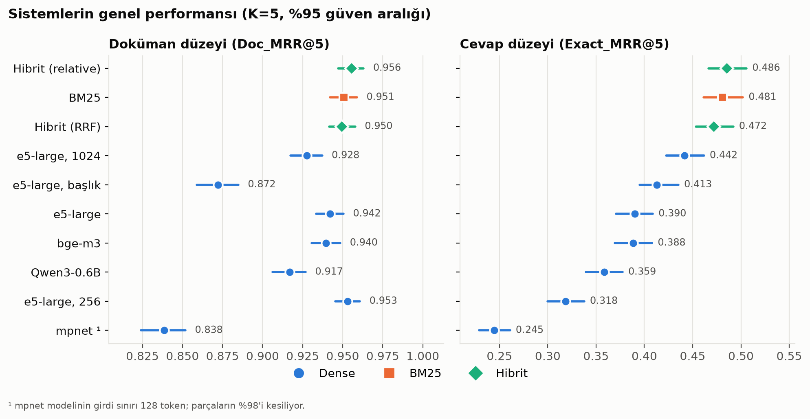
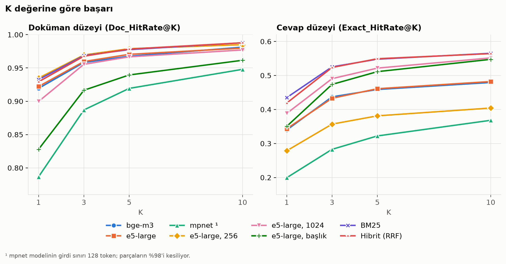
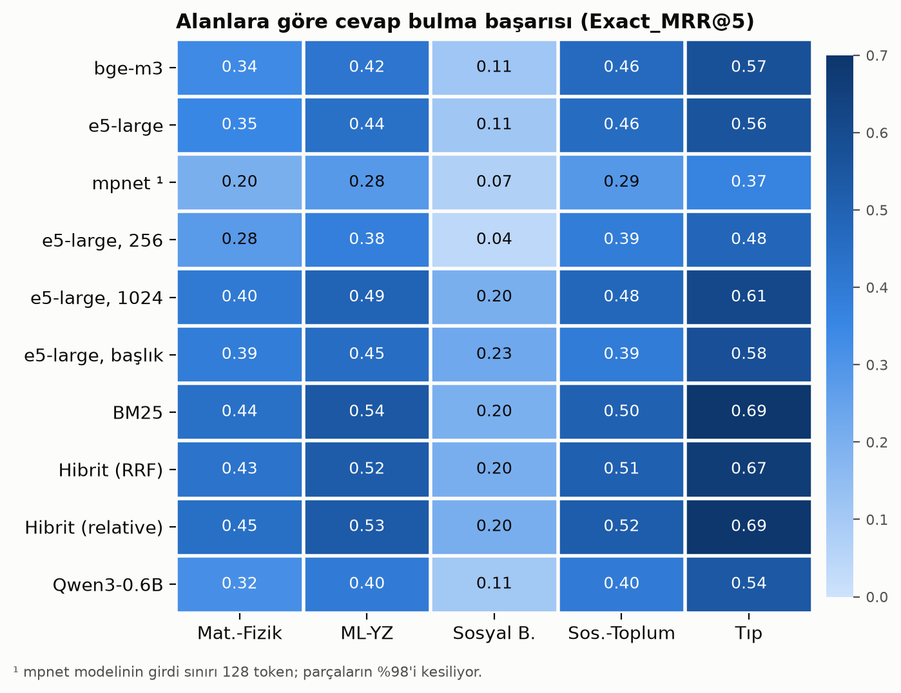
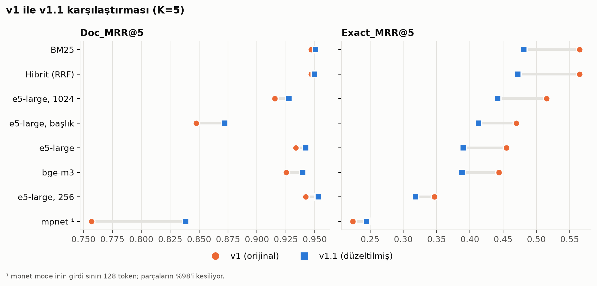

# Turkish RAG Benchmark

Türkçe akademik metinler üzerinde **bilgi getirme (retrieval)** sistemlerini değerlendirmek için hazırlanmış bir benchmark veri seti ve değerlendirme paketi.

[](LICENSE)
[](https://www.python.org/)

> **Sürüm:** v1.1. Veri seti v1 ile aynıdır, değerlendirme kodu yeniden yazılmış ve düzeltilmiştir ([v1 ile farklar](#v1-ile-farklar)).

## İçindekiler

- [Genel bakış](#genel-bakış)
- [Veri seti](#veri-seti)
- [Kurulum](#kurulum)
- [Kullanım](#kullanım)
- [Değerlendirme yöntemi](#değerlendirme-yöntemi)
- [Sonuçlar](#sonuçlar)
- [v1 ile farklar](#v1-ile-farklar)
- [Proje yapısı](#proje-yapısı)
- [Lisans](#lisans)

## Genel bakış

Depo üç parçadan oluşur:

1. **Derlem:** 5 akademik alandan 235 Türkçe makale (PDF ve temizlenmiş Markdown).
2. **Soru-cevap seti:** Makalelerden LLM'lerle üretilmiş 2132 soru, referans cevap ve kaynak doküman bilgisi.
3. **Değerlendirme paketi (`trrag`):** Dense, BM25 ve hibrit retriever'ları aynı soru setinde karşılaştıran; güven aralıkları ve anlamlılık testleri üreten, config dosyalarıyla çalışan bir Python paketi.

Öne çıkan sonuçlar (K=5, ayrıntılar [Sonuçlar](#sonuçlar) bölümünde):

- **BM25**, test edilen tüm dense modellerden daha iyi ya da onlara eşit sonuç veriyor. Ancak bu üstünlük kısmen veri setinden kaynaklanıyor: soru kelimelerinin %71.5'i kaynak metinde birebir geçiyor.
- **multilingual-e5-large** ile **bge-m3** arasında istatistiksel olarak anlamlı bir fark yok.
- **Hibrit arama** (BM25 + dense, RRF füzyonu) BM25'e anlamlı bir katkı sağlamıyor.
- Küçük parçalar (256 token) doğru dokümanı bulmada daha başarılı. Büyük parçaların cevap bulmadaki avantajı ise büyük ölçüde metriğin uzun parçaları kayırmasından kaynaklanıyor.

## Veri seti

### Derlem

| Alan | Klasör | Ham PDF | Temizlenmiş doküman | Soru |
| :--- | :--- | ---: | ---: | ---: |
| Matematik ve Fizik | `matematik-fizik` | 50 | 48 | 480 |
| Makine Öğrenmesi ve Yapay Zekâ | `ml-ai` | 50 | 50 | 302 |
| Sosyal Bilimler | `sosyal_bilimler` | 40 | 40 | 400 |
| Sosyal ve Toplum Bilimleri | `sosyal_toplum_bilimleri` | 50 | 47 | 450 |
| Tıp | `tip` | 50 | 50 | 500 |
| **Toplam** | | **240** | **235** | **2132** |

Temizlenmiş dokümanların medyan uzunluğu 3.330 kelime, derlemin toplamı yaklaşık 954 bin kelimedir. Sorular ve cevaplar medyan 20–21 kelimedir.

### Hazırlama süreci

1. **Toplama:** Her alandan Türkçe akademik makaleler PDF olarak derlendi (`data/raw/`).
2. **Metne dönüştürme:** PDF'ler [Docling](https://github.com/DS4SD/docling) ile Markdown'a çevrildi (`data/processed/stage1_extracted/`, betik: `notebooks/extract_text.ipynb`).
3. **Temizleme:** Sayfa numarası, üst/alt bilgi gibi gürültüler düzenli ifadelerle temizlendi (`data/processed/stage2_cleaned/`). Bu aşamada 5 doküman kayboldu (`FM25`, `FM39`, `SOS15`, `SOS29`, `SOS44`).
4. **Soru üretimi:** Temizlenmiş metinlerin bölümlerinden (Özet, Giriş, Bulgular vb.) Gemini 3.5 Flash, Gemini 3.1 Pro ve Claude Opus 4.6 modelleriyle soru-cevap çiftleri üretildi (`data/benchmark/`). Doküman başına 6–10 soru düşmektedir.

### Soru formatı

Her alan için bir JSON dosyası bulunur (`data/benchmark/<alan>_qa_dataset.json`):

```json
{
  "question": "Psikolojik iyi oluş nedir ve Ryff'e göre nasıl tanımlanmıştır?",
  "ground_truth": "Psikolojik iyi oluş, içinde doyumlu bir yaşam ve öz değeri barındıran duygu ve düşüncelerle ilişkilendirilmiş bir kavramdır. ...",
  "source_file": "SOS01.md",
  "source_section": "## Giriş"
}
```

Değerlendirme paketi her soruya `<dosya_adı>_<sıra>` biçiminde bir kimlik atar (ör. `tip_qa_dataset.json_17`).

### Bilinen sınırlılıklar

- **Kopya dokümanlar:** `FM04` = `FM22`, `FM05` = `FM21` ve `m20` = `m44` aynı makalelerdir (52 soruyu etkiler). Değerlendirme paketi bunları aynı doküman sayar.
- **Bağlama bağımlı sorular:** ~305 soru (%14) "Bu çalışmada…" gibi ifadeler içerir ve derlem içinde tek başına anlam taşımaz.
- **Sözcüksel örtüşme:** Soru içerik kelimelerinin %71.5'i kaynak dokümanda birebir aynı biçimde geçer. Bu durum leksikal yöntemleri (BM25) avantajlı kılar.
- **Cevap tavanı:** Kaynak dokümanın tamamı verilse bile soruların yalnızca %77'si (1635/2132) exact eşleşme eşiğini geçebilir. Bunun sebebi, bazı referans cevapların metinden fazla uzaklaşmış olmasıdır.
- **Doğrulama:** Soruların insanlar tarafından sistematik olarak doğrulandığına dair bir kayıt yoktur. Temizleme kuralları ve soru üretim prompt'ları da korunmamıştır.
- **Kanıt aralığı yok:** Cevabın metindeki konumu kaydedilmemiştir; sadece kaynak dosya ve bölüm bilinir.
- **Doygunluk:** 235 dokümanlık derlemde doğru dokümanı bulma görevi kolaydır (Doc_HitRate@10 ≈ 0.98).

## Kurulum

Python 3.10 veya üzeri gerekir. GPU kullanılacaksa önce CUDA'lı PyTorch kurulmalıdır.

```bash
git clone https://github.com/Turkish-RAG-Benchmark/turkish-rag-benchmark.git
cd turkish-rag-benchmark
python -m venv .venv
.venv/Scripts/activate        # Linux/macOS: source .venv/bin/activate
pip install torch --index-url https://download.pytorch.org/whl/cu126   # sadece GPU için
pip install -e ".[dev]"
pytest
```

## Kullanım

Deneyler `configs/` altındaki YAML dosyalarıyla tanımlanır:

```bash
python -m trrag.evaluate --config configs/v1_fixed.yaml            # tüm sistemler
python -m trrag.evaluate --config configs/v1_fixed.yaml --only "RAG-7 (BM25 Only)"
python -m trrag.evaluate --config configs/smoke.yaml --limit 100   # hızlı deneme
```

| Config | İçerik |
| :--- | :--- |
| `v1_fixed.yaml` | 8 sistem (düzeltilmiş), ablasyonlar ve Qwen3-Embedding-0.6B |
| `v1_compat.yaml` | 8 sistemin v1 davranışıyla yeniden üretimi |
| `bm25_tokenizers.yaml` | BM25 tokenizasyon karşılaştırması (GPU gerektirmez) |
| `ablation_e5base.yaml` | Füzyon modu, önek ve parça boyutu ablasyonu (multilingual-e5-base) |
| `smoke.yaml` | Küçük modelle hızlı kod kontrolü |

Bir sistem tanımı örneği:

```yaml
- name: RAG-8 (Hybrid RRF)
  chunking: {type: sentence, size: 1024, overlap: 200}
  retriever:
    type: hybrid
    mode: rrf            # rrf | relative_score | simple
    candidate_k: 50
    components:
      - {type: dense, model: intfloat/multilingual-e5-large}
      - {type: bm25, tokenizer: tr_snowball}
```

Her koşu `results/runs/<config>/<zaman>/` altına şu dosyaları yazar:

| Dosya | İçerik |
| :--- | :--- |
| `summary.csv` | Tüm metrikler; K değerine ve alt kümeye göre, güven aralıklarıyla |
| `summary_wide.csv` | Sistem × metrik özet tablosu |
| `per_query.csv` | Her soru için doğru doküman ve doğru cevabın sırası |
| `comparisons.csv` | Config'te tanımlanan sistem çiftleri için anlamlılık testleri |
| `run.json` | Config, ortam bilgisi, parça istatistikleri, hatalar |

Grafikler sonuç dosyalarından yeniden üretilebilir (`pip install -e ".[figures]"` gerekir):

```bash
python scripts/make_figures.py --run results/v1_fixed --out results/figures/v1.1
```

Yoğun (dense) modellerin parça embedding'leri `.cache/` altında saklanır; aynı ayarlarla tekrar koşulduğunda yeniden hesaplanmaz. Modeller yerel bir klasörde duruyorsa `TRRAG_MODEL_DIRS` ortam değişkeniyle gösterilebilir (`<klasör>/<org>__<model>` yapısında).

## Değerlendirme yöntemi

### Görevler

Her soru için retriever ilk 10 parçayı (chunk) getirir. İki düzeyde değerlendirme yapılır:

- **Doküman düzeyi (Doc):** Getirilen parçalardan ilkinin, sorunun üretildiği dokümana ait olduğu sıra.
- **Cevap düzeyi (Exact):** Referans cevaptaki içerik kelimelerinin en az %70'ini içeren ilk parçanın sırası. Kelimeler Türkçe'ye uygun küçük harfe çevrilir; üç harften kısa kelimeler ve stopword'ler çıkarılır; eşleşme tam kelime üzerinden yapılır.

### Metrikler

Her sorunun tek bir ilgili dokümanı ve tek bir referans cevabı olduğu için bütün metrikler ilk doğru sonucun sırasından (r) hesaplanır:

| Metrik | Tanım |
| :--- | :--- |
| HitRate@K | r ≤ K ise 1, değilse 0 |
| MRR@K | r ≤ K ise 1/r, değilse 0 |
| nDCG@K | r ≤ K ise 1/log₂(r+1), değilse 0 |

Raporlanan değerler 2132 sorunun ortalamasıdır. Güven aralıkları 1000 tekrarlı bootstrap ile (%95) hesaplanır. İki sistem arasındaki fark, aynı sorular üzerinde eşleştirilmiş permütasyon testi (10.000 permütasyon) ile sınanır. Sonuçlar ayrıca alt kümeler için de raporlanır: bağlamdan bağımsız sorular, cevabı kaynak metinde bulunabilen sorular ve alanlar.

### Sistemler

| Sistem | Retriever | Model / Yöntem | Parçalama |
| :--- | :--- | :--- | :--- |
| RAG-1 | Dense | `BAAI/bge-m3` | 512 / 128 |
| RAG-2 | Dense | `intfloat/multilingual-e5-large` | 512 / 128 |
| RAG-3 | Dense | `sentence-transformers/paraphrase-multilingual-mpnet-base-v2` | 512 / 128 |
| RAG-4 | Dense | `intfloat/multilingual-e5-large` | 256 / 50 |
| RAG-5 | Dense | `intfloat/multilingual-e5-large` | 1024 / 200 |
| RAG-6 | Dense | `intfloat/multilingual-e5-large` | Markdown başlıkları |
| RAG-7 | BM25 | Türkçe Snowball stemmer, Türkçe stopword | 1024 / 200 |
| RAG-8 | Hibrit | RAG-5 + RAG-7, Reciprocal Rank Fusion | 1024 / 200 |

Parça boyutları, llama-index `SentenceSplitter` ile tiktoken (cl100k) token'ı cinsinden verilmiştir (boyut / örtüşme). e5 modellerine `query: ` / `passage: ` önekleri eklenir.

## Sonuçlar

K=5, 2132 soru. Köşeli parantez içindeki değerler %95 güven aralığıdır.

| Sistem | Doc_HitRate@5 | Doc_MRR@5 | Exact_HitRate@5 | Exact_MRR@5 |
| :--- | :---: | :---: | :---: | :---: |
| RAG-1 (bge-m3) | 0.968 [0.960–0.975] | 0.940 [0.931–0.948] | 0.459 [0.438–0.480] | 0.388 [0.369–0.408] |
| RAG-2 (e5-large) | 0.970 [0.963–0.977] | 0.942 [0.934–0.950] | 0.461 [0.440–0.482] | 0.390 [0.371–0.409] |
| RAG-3 (mpnet) ¹ | 0.919 [0.907–0.930] | 0.838 [0.824–0.852] | 0.322 [0.303–0.342] | 0.245 [0.229–0.261] |
| RAG-4 (256/50) | 0.979 [0.973–0.985] | 0.953 [0.945–0.961] | 0.381 [0.360–0.402] | 0.318 [0.300–0.338] |
| RAG-5 (1024/200) | 0.967 [0.958–0.975] | 0.928 [0.917–0.937] | 0.522 [0.501–0.543] | 0.442 [0.423–0.462] |
| RAG-6 (Markdown başlıkları) | 0.939 [0.929–0.950] | 0.872 [0.859–0.885] | 0.511 [0.490–0.535] | 0.413 [0.395–0.435] |
| RAG-7 (BM25) | 0.977 [0.971–0.983] | 0.951 [0.942–0.959] | 0.548 [0.526–0.569] | 0.481 [0.461–0.502] |
| RAG-8 (Hibrit, RRF) | 0.978 [0.971–0.984] | 0.950 [0.942–0.958] | 0.549 [0.529–0.570] | 0.472 [0.453–0.492] |
| Hibrit, relative_score | 0.979 [0.972–0.985] | 0.956 [0.947–0.963] | 0.548 [0.528–0.570] | 0.486 [0.466–0.506] |
| Qwen3-Embedding-0.6B | 0.956 [0.948–0.965] | 0.917 [0.906–0.927] | 0.440 [0.419–0.460] | 0.359 [0.340–0.377] |

¹ Modelin girdi sınırı 128 token olduğundan 512'lik parçaların %98'i kesilmektedir; bu sistemin sonuçları modelin gerçek kapasitesini yansıtmaz.

Tüm K değerleri, alt kümeler ve karşılaştırmalar: [`results/v1_fixed/`](results/v1_fixed/).







### Bulgular

1. **Embedding modelleri:** e5-large ile bge-m3 eşdeğerdir (Exact_MRR@5 p=0.69, Doc_MRR@5 p=0.44). Qwen3-Embedding-0.6B her ikisinden de anlamlı ölçüde düşüktür (p<0.001). e5 öneklerinin anlamlı bir etkisi yoktur (p=0.28).
2. **Parça boyutu:** 256'lık parçalar doğru dokümanı 1024'lük parçalardan daha iyi bulur (Doc_MRR@5 0.953'e karşı 0.928, p<0.001). 1024'lük parçalar exact metriklerde öndedir (p<0.001), ancak bu fark parça uzunluğuyla birlikte artmaktadır: multilingual-e5-base ile Exact_MRR@5, ortalama 145 kelimelik parçalarda 0.386, 245 kelimede 0.424, 296 kelimede 0.432'dir. Uzun parçalar cevap kelimelerini kendiliğinden daha sık içerdiğinden bu fark retrieval kalitesinin doğrudan bir ölçüsü değildir.
3. **BM25:** Exact_MRR@5'te tüm dense modellerden iyidir (RAG-5'e karşı p<0.001). Türkçe stemmer ile İngilizce stemmer arasında fark yoktur (p=0.66). Sorular ile kaynak metin arasındaki yüksek sözcük örtüşmesi düşünüldüğünde bu sonuç dikkatle yorumlanmalıdır.
4. **Hibrit arama:** RRF füzyonu doküman düzeyinde BM25'e eşittir (p=0.69), exact düzeyinde biraz daha düşüktür (p=0.01). relative_score füzyonu BM25'e eşittir (p=0.14).
5. **Alanlar:** Sosyal Bilimler alanında exact skorları belirgin şekilde düşüktür (Exact_MRR@5 0.11–0.20). Bu alandaki referans cevaplar kaynak metinden daha fazla uzaklaşmıştır.

## v1 ile farklar

v1'in değerlendirme notebook'unda (`notebooks/rag-benchmarks.ipynb`) sonuçları etkileyen sorunlar tespit edildi. Değerlendirme kodu `src/trrag` paketi olarak yeniden yazıldı.

**Yeniden üretim:** Yeni paket, v1'in davranışı taklit edilecek şekilde çalıştırıldığında (`configs/v1_compat.yaml`) 8 sistemin tamamını orijinal skorlara ortalama 0.0011, en fazla 0.0028 farkla üretir ([`results/v1_reproduction.csv`](results/v1_reproduction.csv)). Böylece aşağıdaki farkların düzeltmelerden kaynaklandığı doğrulanmıştır.

| # | v1'deki sorun | Etkisi | v1.1 |
| :--- | :--- | :--- | :--- |
| H1 | Hibrit füzyon `simple` modunda çalıştı; BM25 skorları (~10–30) cosine skorlarını (0–1) ezdi | Hibrit sistem BM25 ile aynı sonucu verdi | RRF |
| H2 | BM25 İngilizce stemmer ve stopword kullandı | Anlamlı fark yok (p=0.66) | Türkçe tokenizasyon |
| H3 | e5 modeline `query:` / `passage:` önekleri verilmedi | Anlamlı fark yok (p=0.28) | Önekler eklendi |
| H4 | Exact metriği kelimeleri alt dize olarak aradı ("veri" → "verilerin") | Exact skorlar ~9 puan yüksek çıktı (BM25 Exact_MRR@5: 0.572 → 0.481) | Tam kelime eşleşmesi |
| H5 | Hata veren sorgular ortalamadan sessizce çıkarıldı | Etki ölçülemedi | Hatalar kaydediliyor |
| H6 | Recall = HitRate ve MAP = MRR olduğu halde ayrı raporlandı | Tablolar gereksiz yere kalabalık | HitRate, MRR, nDCG |
| H7 | En iyi ayarlar test seti üzerinden ve sırayla seçildi | Seçim yanlılığı | Seçim yapılmıyor; tüm sistemler raporlanıyor |
| H8 | Güven aralığı ve anlamlılık testi yoktu | Küçük farklar yorumlanamıyordu | Bootstrap ve permütasyon testi |
| H9 | 1024'lük parçaların %79'u e5'in 512 token sınırını aştı | Parçaların sonu embedding'e girmedi | Parçaları modelin tokenizer'ıyla ölçme seçeneği |
| H10 | mpnet'in 128 token sınırı nedeniyle parçaların %98'i kesildi | Model metnin çoğunu görmedi | Not edildi |
| — | Kopya dokümanlar farklı doküman sayıldı | Doğru metni getiren sistem hatalı sayıldı | Aynı doküman kabul ediliyor |



Doküman düzeyindeki küçük artışlar kopya dokümanların birleştirilmesinden, exact düzeyindeki düşüşler ise metriğin düzeltilmesinden (H4) kaynaklanır. mpnet'teki büyük artışın sebebi, v1'de her parçanın başına eklenen dosya yolu meta verisinin modelin zaten kısa olan 128 token'lık girdisinden yer yemesidir: diğer her şey aynıyken yalnızca bu meta veriyi kaldırmak Doc_MRR@5'i 0.761'den 0.838'e çıkarır (p<0.001).

v1'in orijinal sonuçları [`results/tables/rag_evaluation_results.csv`](results/tables/rag_evaluation_results.csv) ve `results/figures/` altında (v1 grafikleri) korunmaktadır. v1 ile v1.1'in sistem bazında karşılaştırması: [`results/v1_original_vs_fixed.csv`](results/v1_original_vs_fixed.csv).

## Proje yapısı

```
turkish-rag-benchmark/
├── data/
│   ├── raw/                  Ham PDF'ler (alan klasörlerinde)
│   ├── processed/
│   │   ├── stage1_extracted/ Docling çıktısı Markdown
│   │   └── stage2_cleaned/   Temizlenmiş Markdown (değerlendirmede kullanılan derlem)
│   └── benchmark/            Soru-cevap setleri (JSON)
├── src/trrag/                Değerlendirme paketi
│   ├── data.py               Derlem ve soru yükleme
│   ├── text.py               Türkçe normalizasyon ve BM25 tokenizer'ları
│   ├── chunking.py           Parçalama
│   ├── retrievers.py         Dense, BM25 ve hibrit retriever'lar
│   ├── metrics.py            Metrikler, bootstrap, permütasyon testi
│   └── evaluate.py           Deney çalıştırıcı (CLI)
├── configs/                  Deney tanımları
├── scripts/                  Yardımcı betikler (koşu karşılaştırma, grafikler)
├── tests/                    Birim testleri
├── results/
│   ├── v1_fixed/             v1.1 sonuçları
│   ├── v1_compat/            v1'in yeniden üretimi
│   ├── figures/v1.1/         v1.1 grafikleri
│   ├── tables/, figures/     v1'in orijinal sonuçları
│   └── *.csv                 v1 karşılaştırma tabloları
└── notebooks/                v1 notebook'ları (PDF dönüştürme, orijinal değerlendirme)
```

## Lisans

Kaynak kod (`src/`, `scripts/`, `tests/`, `configs/`, `notebooks/`) [MIT Lisansı](LICENSE) ile lisanslanmıştır.

`data/raw/` altındaki makaleler ve bunlardan türetilen metinlerin hakları ilgili yazarlara ve yayıncılara aittir; MIT lisansı bu içerikleri kapsamaz.
